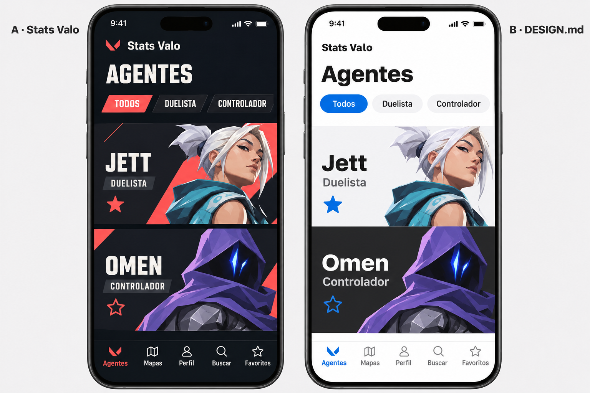

# Stats Valo

A direção aprovada é a **A**, à esquerda no mockup. O fundo grafite azulado enquadra a arte dos agentes. O coral destaca a aba e o filtro ativos, os favoritos e a ação principal de cada tela. Barlow Condensed dá presença aos títulos e nomes dos agentes. Inter mantém legíveis as descrições, funções e estatísticas.

## Catálogo de agentes e mapas

- Na aba Agentes, coloque o título e os filtros por função acima de uma lista vertical. Mostre o nome e a função de cada agente de um lado e um recorte amplo do retrato do outro.
- Use estrelas preenchidas e contornadas para distinguir o estado de favorito. Mantenha o botão separado do toque que abre o detalhe e dê a ele um rótulo acessível.
- Use cortes diagonais e detalhes geométricos discretos nas áreas de imagem. Preserve a legibilidade dos nomes e das funções quando o retrato ocupar a maior parte do card.
- Nos mapas, use a arte em formato horizontal com o nome em destaque. No detalhe, mostre a composição recomendada com retrato, nome, função e uma frase sobre a contribuição de cada agente no mapa.
- Use os retratos, imagens e ícones da Valorant-API nas telas. O mockup orienta a composição e a hierarquia visual.

## Navegação e outras telas

- Mantenha as cinco abas com ícone e rótulo visível, na ordem Agentes, Mapas, Perfil, Buscar e Favoritos. Use o coral no ícone e no texto da aba ativa.
- Na tela inicial, dê destaque ao campo Riot ID e à ação de continuar. Deixe “Explorar sem Riot ID” visível como ação secundária.
- Em Perfil e Buscar, use a mesma hierarquia para os dados do jogador. Mostre rank e nível no topo, seguidos de K/D e partidas recentes.
- Use grafite para superfícies, texto claro para conteúdo principal e cinza claro para informações secundárias. Em botões preenchidos de coral, use texto grafite.
- Respeite as áreas seguras do aparelho, ofereça alvos de toque de pelo menos 48 unidades lógicas e permita que textos e listas acomodem fontes ampliadas.
