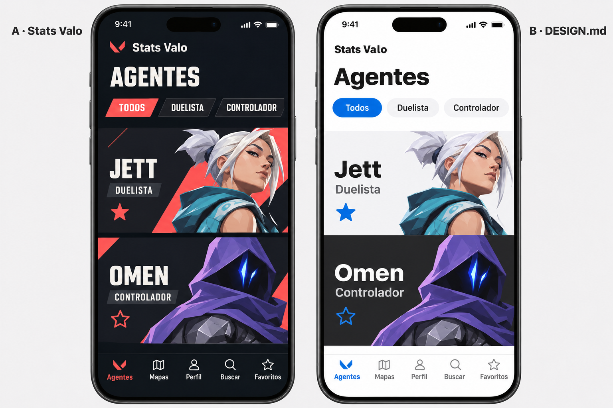
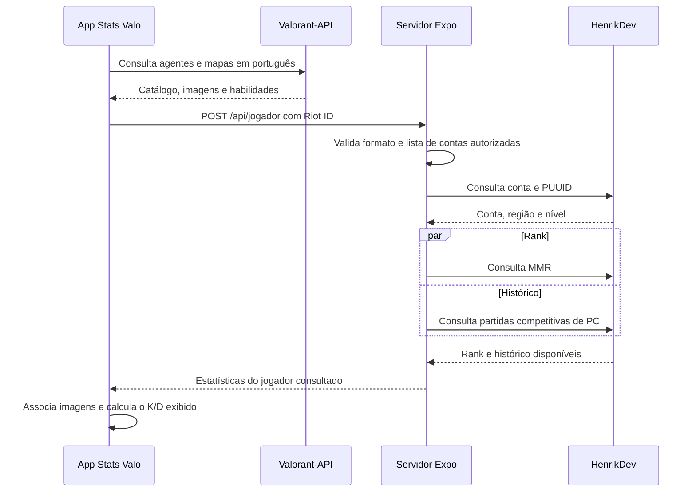

# Stats Valo

**Aplicativo acadêmico de consulta de Valorant desenvolvido por Pedro Augusto e Yago Presot.**

O Stats Valo reúne informações sobre agentes, mapas e desempenho de jogadores em uma aplicação feita com Expo, React Native e TypeScript. O usuário pode estudar as habilidades dos agentes, salvar favoritos, consultar composições de equipe e acompanhar estatísticas a partir de um Riot ID no formato `nome#tag`.

O projeto aplica conceitos de desenvolvimento móvel presentes no material de aula, como componentes reutilizáveis, gerenciamento de estado, efeitos, listas, navegação, consumo de APIs REST e armazenamento local. O exemplo Mercado Cripto, referenciado nas aulas, serviu como base conceitual para abas, listas e favoritos persistentes.

## Guia de leitura

- [Funcionalidades e telas](#funcionalidades-e-telas)
- [Navegação](#navegação)
- [Tecnologias utilizadas](#tecnologias-utilizadas)
- [APIs e fluxo dos dados](#apis-e-fluxo-dos-dados)
- [Regras de funcionamento](#regras-de-funcionamento)
- [Organização do código](#organização-do-código)
- [Como executar](#como-executar)
- [Roteiro de demonstração para avaliação](#roteiro-de-demonstração-para-avaliação)
- [Verificações](#verificações)
- [Escopo e limitações atuais](#escopo-e-limitações-atuais)
- [Referências e créditos](#referências-e-créditos)

## Funcionalidades e telas

| Tela | O que permite fazer |
| --- | --- |
| **Inicial** | Apresenta o app com a arte da Jett, oferece “Fazer login” por Riot ID e “Entrar sem login” e valida o identificador informado. A escolha de entrada fica salva. |
| **Agentes** | Lista os agentes jogáveis recebidos da API, com retrato, nome e função. Oferece filtros por função e botão de favorito. |
| **Detalhe do agente** | Exibe descrição, função e as quatro habilidades ativas, com seus ícones e explicações. A marcação visual recebida da API é removida das descrições. |
| **Mapas** | Mostra imagens e nomes dos mapas 5v5 contemplados pelas recomendações do projeto. |
| **Composições do mapa** | Apresenta duas formações de cinco agentes para cada mapa, com função e contribuição tática. Agentes favoritos recebem estrela e borda coral. Também analisa as partidas recentes do jogador naquele mapa e sugere ajustes para experimentar. Cada agente abre seu detalhe. |
| **Perfil** | Reúne a Central de Evolução com rank, nível, RR, gráficos de desempenho, comparação por agente e histórico de até dez partidas competitivas de PC. Permite alternar entre os recortes de cinco e dez partidas, trocar ou remover o Riot ID. |
| **Detalhe da partida** | Abre o mapa, resultado, placar, K/D/A, headshots, ACS, dano por round e as duas equipes com destaque para o jogador consultado. |
| **Montador de equipe** | Permite escolher cinco agentes para um mapa, experimentar as formações recomendadas e acompanhar a cobertura das quatro funções. Favoritos recebem destaque nas escolhas. |
| **Buscar** | Consulta outro Riot ID autorizado para a demonstração, sem substituir o identificador salvo no Perfil. |
| **Favoritos** | Reúne os agentes marcados e permite abrir seus detalhes ou remover a marcação. |
| **Sobre** | Apresenta o objetivo, os autores e as fontes dos dados. |
| **Termos de uso e Política de privacidade** | Explicam a finalidade acadêmica, as consultas realizadas e os dados armazenados no aparelho. |

As funções disponíveis para filtro são Duelista, Controlador, Iniciador e Sentinela. O catálogo de agentes acompanha a resposta da API. As recomendações cobrem **13 mapas**, totalizando **26 composições** mantidas no projeto.

As partidas recentes exibem retrato do agente, miniatura do mapa, resultado e os números de abates, mortes e assistências em formato compacto, como `K/D/A 14 / 16 / 8`. No Perfil, o título da partida apresenta o agente antes do mapa.

### Identidade visual

A interface utiliza fundo grafite azulado, destaques em coral, retratos amplos e elementos diagonais. Os títulos usam Barlow Condensed e os textos gerais usam Inter. Os filtros têm rolagem horizontal para acomodar telas menores.

A especificação de cores, tipografia e componentes está no [DESIGN.md](DESIGN.md). O comparativo abaixo registra a etapa de definição visual. A proposta aprovada está à esquerda.



*Imagem de referência visual usada no planejamento. A interface implementada utiliza as artes fornecidas pela Valorant-API.*

## Navegação

O Expo Router organiza as rotas dentro de `src/app/`. As cinco áreas principais são acessadas pelas abas inferiores. Uma Stack abre os detalhes e as páginas informativas.

```text
Tela Inicial
└── Abas inferiores
    ├── Agentes ────── Detalhe do Agente
    ├── Mapas ──────── Composições do Mapa ── Detalhe do Agente
    ├── Perfil ─────── Sobre / Termos de uso / Política de privacidade
    ├── Buscar
    └── Favoritos ──── Detalhe do Agente
```

A tela inicial aparece no primeiro acesso. Depois de continuar ou escolher explorar, a entrada passa a levar diretamente às abas. “Fazer login” salva o Riot ID no aparelho para consultar o Perfil. Quem entrou sem login pode cadastrá-lo posteriormente no Perfil. Termos e privacidade também ficam acessíveis na tela inicial.

## Tecnologias utilizadas

| Tecnologia | Uso no projeto |
| --- | --- |
| Expo SDK 58 | Ambiente de desenvolvimento e integração das funcionalidades multiplataforma. |
| React Native 0.88 e React 19.3 | Componentes, composição das telas e atualização da interface. |
| TypeScript | Tipagem de agentes, mapas, preferências, jogadores e partidas. |
| Expo Router | Navegação por arquivos, abas, Stack e rota de servidor. |
| Context API e hooks do React | Compartilhamento do catálogo e das preferências, estado dos formulários e efeitos de carregamento. |
| AsyncStorage | Persistência local do Riot ID, dos favoritos e da escolha de entrada. |
| Expo Image | Exibição dos retratos, mapas e ícones, com suporte de cache da biblioteca. |
| Expo Font e Ionicons | Fontes locais e ícones de navegação e favoritos. |
| React Native Safe Area Context | Espaçamento em relação às áreas reservadas pelo sistema do aparelho. |
| Fetch e AbortController | Requisições HTTP e cancelamento de consultas quando o componente é desmontado. |
| ESLint e TypeScript | Análise estática e verificação de tipos do projeto. |

## APIs e fluxo dos dados

### Valorant-API

O app consulta diretamente os recursos públicos da Valorant-API em português.

| Recurso utilizado | Dados aproveitados |
| --- | --- |
| `GET /v1/agents?language=pt-BR&isPlayableCharacter=true` | Identificador, nome, descrição, função, retratos, ícones e habilidades dos agentes jogáveis. |
| `GET /v1/maps?language=pt-BR` | Identificador, nome e imagens dos mapas. |

Os agentes e mapas ficam compartilhados em memória pelo contexto da aplicação durante a sessão. O catálogo completo de mapas é filtrado pelos identificadores que possuem composições no projeto. A correspondência entre partidas e imagens utiliza os IDs recebidos, com comparação pelo nome como alternativa.

### HenrikDev

O aplicativo envia o Riot ID para `POST /api/jogador`, uma rota de servidor do próprio Expo Router. Essa rota acessa a HenrikDev e devolve os dados necessários para a tela.

| Recurso utilizado | Finalidade |
| --- | --- |
| `GET /valorant/v2/account/{name}/{tag}` | Identificar a conta, o PUUID, a região e o nível. |
| `GET /valorant/v3/by-puuid/mmr/{região}/pc/{puuid}` | Consultar o rank atual e os pontos RR. |
| `GET /valorant/v4/by-puuid/matches/{região}/pc/{puuid}?mode=competitive&size=10` | Consultar até dez partidas competitivas recentes. |

Primeiro, o servidor resolve a conta. Em seguida, consulta rank e histórico em paralelo. As partidas são ordenadas da mais recente para a mais antiga, e o jogador é localizado pelo PUUID. O resultado é associado ao seu time pelo identificador do time.



A chave fica na variável `HENRIK_API_KEY`, utilizada pelo servidor. A configuração local usa `.env.local`, ignorado pelo Git. A lista `STATS_VALO_ALLOWED_RIOT_IDS` limita as consultas às contas autorizadas para a demonstração acadêmica. As respostas dessa rota incluem `Cache-Control: no-store`.

## Regras de funcionamento

### Riot ID e dados locais

O Riot ID deve conter nome e tag separados por `#`. O app remove espaços nas extremidades, preserva espaços internos do nome e rejeita campos vazios, múltiplos separadores e caracteres de controle.

As preferências são armazenadas como JSON no AsyncStorage sob a chave `@stats-valo/preferences`.

| Informação salva | Finalidade |
| --- | --- |
| `riotId` | Abrir o Perfil com a conta escolhida. |
| `favorites` | Guardar os UUIDs dos agentes favoritos. |
| `started` | Registrar que o usuário já concluiu a entrada inicial. |

As gravações são executadas em sequência para preservar atualizações feitas em rápida sucessão. A interface confirma a mudança após a persistência bem-sucedida. As consultas usam um cache em memória de um minuto para reutilizar os dados ao abrir uma partida. A aba Buscar exibe as cinco partidas mais recentes. A Central de Evolução permite selecionar os recortes de cinco ou dez partidas disponíveis.

### Central de Evolução

O Perfil oferece três seções. **Resumo** reúne taxa de vitórias, K/D acumulado, porcentagem de headshots, sequência de resultados, gráfico de abates por partida e comparação por mapa. **Agentes** agrupa as partidas por personagem e mostra quantidade de jogos, K/D, vitórias e headshots, com acesso às habilidades. **Partidas** abre o histórico e seus detalhes.

Os gráficos seguem a ordem cronológica, da partida mais antiga para a mais recente. A taxa de vitórias usa os resultados conhecidos do recorte. Headshots representa a proporção dos impactos na cabeça sobre os impactos totais registrados. ACS é a pontuação de combate dividida pelo número de rounds. O dano médio por round segue a mesma divisão. Valores ausentes aparecem como um traço.

O placar detalhado identifica os personagens e o jogador consultado, destacado como “Você”. Os nomes das demais contas ficam fora da resposta enviada ao aplicativo.

### K/D e K/D/A

O resumo calcula o K/D a partir das partidas efetivamente exibidas.

```text
K/D = soma dos abates / soma das mortes
```

Por exemplo, duas partidas com `20/10` e `5/15` produzem `25/25`, resultando em **1,00**. O cálculo considera os totais acumulados. Quando há abates e zero mortes, o valor exibido é `∞`. Sem partidas ou com ambos os totais zerados, aparece `—`.

Cada card mostra também o **K/D/A**, que apresenta os três valores individuais da partida na ordem abates, mortes e assistências.

### Composições recomendadas

Cada mapa possui uma formação principal e uma alternativa com proposta tática própria. São cinco agentes distintos por formação, acompanhados de explicações sobre como podem contribuir naquele mapa.

A ação **Montar minha equipe** abre cinco espaços de seleção. É possível partir da formação principal ou alternativa, buscar agentes e trocar escolhas. A cobertura de funções é atualizada a cada seleção, e uma opção da formação principal pode ser sugerida para ampliar essa cobertura, priorizando favoritos. A análise utiliza a distribuição de funções e explica esse critério na tela. A equipe montada permanece no estado da tela durante a edição.

Essas recomendações são conteúdo editorial definido no código. Sua manutenção é feita em `src/lib/compositions.ts`. Os favoritos do usuário são cruzados com as duas formações para destacar agentes já marcados.

A seção **Como melhorar neste mapa** filtra o histórico recente pelo mapa aberto e mostra quantidade de partidas, K/D e resultados. Sugestões explicáveis usam os totais de abates e mortes, as derrotas e os impactos registrados para propor exercícios de coordenação, revisão e precisão. A tela informa o recorte utilizado e oferece acesso a uma partida daquele mapa para revisão. Quem entrou sem Riot ID recebe um atalho para o Perfil. Mapas sem partidas no histórico recebem uma mensagem específica.

### Carregamento e falhas

As telas apresentam feedback durante as consultas e permitem repetir operações que falharam. A rota de estatísticas trata formato inválido, conta fora da lista de demonstração, configuração ausente, jogador inexistente, limite de consultas e indisponibilidade do serviço.

Rank e histórico são tratados separadamente. Uma falha em um desses recursos permite exibir os demais dados disponíveis. Histórico indisponível e histórico vazio recebem mensagens diferentes.

## Organização do código

```text
src/
├── app/
│   ├── _layout.tsx             # Stack principal, fontes e contexto global
│   ├── index.tsx               # Entrada inicial e cadastro do Riot ID
│   ├── (tabs)/                 # Abas Agentes, Mapas, Perfil, Buscar e Favoritos
│   ├── agente/[id].tsx         # Detalhes e habilidades
│   ├── mapa/[id].tsx           # Composições e destaque de favoritos
│   ├── partida/[id].tsx       # Placar e desempenho individual por partida
│   ├── equipe/[id].tsx        # Montagem interativa de equipe por mapa
│   ├── api/jogador+api.ts      # Integração de servidor com a HenrikDev
│   ├── sobre.tsx
│   ├── termos.tsx
│   └── privacidade.tsx
├── components/
│   ├── agent-list.tsx          # Lista reutilizada em Agentes e Favoritos
│   ├── performance.tsx        # Gráficos e comparação por agente e mapa
│   ├── player-stats.tsx        # Estatísticas usadas em Perfil e Buscar
│   ├── riot-id-form.tsx        # Formulário de Riot ID
│   └── ui.tsx                  # Estrutura das telas, botões e feedback
└── lib/
    ├── app-state.tsx           # Contexto, catálogo e preferências persistentes
    ├── catalog.ts             # Tipos, consulta e limpeza de textos da API
    ├── compositions.ts        # Formações por mapa e contribuições táticas
    ├── player.ts              # Tipos, validação do Riot ID e cálculo de K/D
    ├── use-player.ts          # Consulta compartilhada e cache de um minuto
    └── theme.ts               # Cores e referências de fontes

assets/fonts/                  # Fontes locais e suas licenças
docs/design/                   # Mockup de referência
.env.example                   # Modelo de configuração sem credenciais
```

A separação permite reutilizar a lista de agentes em Favoritos e a apresentação das estatísticas em Perfil e Buscar. Componentes, estado e utilitários ficam fora do diretório de rotas.

## Como executar

### 1. Preparar o ambiente

Instale **Node.js 22.18 ou superior**, com npm, e Git. É necessária conexão com a internet para consultar as APIs e carregar as imagens.

```bash
git clone https://github.com/pedro-augbs/valorant-tracker.git
cd valorant-tracker
npm ci
```

### 2. Configurar as estatísticas

Copie `.env.example` para `.env.local`. No PowerShell, use o comando abaixo.

```powershell
Copy-Item .env.example .env.local
```

Preencha o arquivo com uma chave válida da HenrikDev e os Riot IDs autorizados para a apresentação.

```dotenv
HENRIK_API_KEY=sua_chave_aqui
STATS_VALO_ALLOWED_RIOT_IDS="JogadorAutorizado#BR1,OutroJogador#TAG"
```

Os identificadores acima são exemplos. Use contas autorizadas e mantenha as aspas na lista para preservar o caractere `#`. Depois de alterar esse arquivo, reinicie o servidor Expo.

O catálogo, os detalhes, as composições e os favoritos podem ser demonstrados antes de configurar a HenrikDev. A consulta de estatísticas passa a funcionar quando a chave e a lista de contas estão preenchidas.

### 3. Iniciar a aplicação

Para a demonstração no navegador, execute o comando abaixo e abra o endereço informado no terminal. A página pode ser avaliada em uma janela estreita ou na visualização de celular do navegador.

```bash
npm run web
```

Para iniciar o servidor de desenvolvimento para um cliente móvel, utilize o comando abaixo.

```bash
npm start
```

O aparelho precisa alcançar o servidor e usar um cliente compatível com o **Expo SDK 58**. O catálogo utiliza a internet, e as consultas de jogadores dependem também da rota de servidor em execução.

| Comando | Finalidade |
| --- | --- |
| `npm run web` | Iniciar a versão web. |
| `npm start` | Iniciar o servidor Expo. |
| `npm run android` | Iniciar o Expo solicitando abertura no Android disponível no ambiente. |
| `npm run ios` | Iniciar o Expo solicitando abertura no iOS disponível no ambiente. |
| `npm run lint` | Executar a análise do ESLint. |
| `npx tsc --noEmit` | Verificar os tipos TypeScript. |

### Dificuldades comuns

| Situação | O que verificar |
| --- | --- |
| “A consulta de estatísticas ainda não foi configurada” | Chave e lista de Riot IDs em `.env.local`, seguidas do reinício do servidor. |
| “Este Riot ID não está autorizado” | Presença da conta na lista `STATS_VALO_ALLOWED_RIOT_IDS`. |
| “Jogador não encontrado” | Nome e tag informados. A consulta depende da localização da conta pelo provedor. |
| Rank indisponível ou histórico vazio | Disponibilidade de dados competitivos de PC para aquela conta. |
| Limite de consultas atingido | Aguardar antes de tentar novamente. |
| Falha no catálogo ou nas imagens | Conexão com a internet e disponibilidade dos serviços externos. |
| A tela inicial já foi concluída | Usar o Perfil para cadastrar ou trocar o Riot ID. Para repetir o primeiro acesso, limpar os dados locais do app ou do site no navegador. |

## Roteiro de demonstração para avaliação

1. **Entrada e validação** — No primeiro acesso, tentar um Riot ID sem `#` para observar a validação. Depois, escolher “Entrar sem login”.
2. **Consumo de API e filtros** — Abrir Agentes, selecionar uma função e observar a atualização da lista.
3. **Navegação de detalhe** — Abrir um agente e conferir descrição, função e quatro habilidades com ícones.
4. **Persistência** — Marcar um agente como favorito, acessar Favoritos e recarregar a aplicação para verificar que a escolha foi mantida.
5. **Relacionamento entre telas** — Abrir um mapa e comparar suas duas composições. Conferir o destaque de um agente favoritado que esteja entre as recomendações e abrir seu detalhe.
6. **Perfil** — Salvar um Riot ID autorizado e conferir nível, rank, RR e a Central de Evolução. Alternar entre cinco e dez partidas e explorar Resumo, Agentes e Partidas. Abrir uma partida para conferir o placar e revisar as habilidades do personagem.
7. **Busca independente** — Buscar uma conta autorizada pela aba Buscar e retornar ao Perfil para verificar a conta salva.
8. **Tratamento de falhas** — Buscar uma conta fora da lista para observar a mensagem de autorização. Uma conta inexistente incluída na lista permite demonstrar o tratamento de jogador não encontrado.
9. **Informações do projeto** — Abrir Sobre, Termos de uso e Política de privacidade a partir do Perfil.
10. **Código e verificações** — Apresentar o contexto compartilhado, o armazenamento local, a rota de servidor e os resultados dos comandos de verificação.

## Verificações

O projeto utiliza ESLint e TypeScript para verificar o código.

```bash
npm run lint
npx tsc --noEmit
```

A validação realizada durante o desenvolvimento incluiu navegação no navegador em larguras de celular, persistência após recarga, consulta real de conta autorizada e exportação do bundle Android.

## Escopo e limitações atuais

- A aplicação foi preparada para uma **demonstração acadêmica fechada**, com consultas restritas às contas configuradas no servidor.
- As estatísticas contemplam **PC e até dez partidas competitivas recentes**. A quantidade exibida depende dos registros concluídos e válidos retornados pelo serviço.
- A seleção de mapas acompanha as recomendações cadastradas no projeto. Mudanças no jogo podem exigir revisão das formações e inclusão de novos mapas.
- Catálogo e estatísticas dependem de conexão e disponibilidade das APIs. As preferências do usuário são persistidas localmente.
- Um aplicativo nativo distribuído para funcionar separadamente do computador de desenvolvimento precisa de um servidor implantado e da origem de produção configurada no Expo Router.
- A exportação do bundle Android foi verificada. A avaliação em aparelho físico e a distribuição pelas lojas continuam pendentes.

## Referências e créditos

- [Valorant-API](https://valorant-api.com/) — Catálogo, imagens e textos do jogo.
- [HenrikDev](https://docs.henrikdev.xyz/) — Consultas de contas e estatísticas.
- [Expo SDK 58](https://docs.expo.dev/versions/v58.0.0/) — Documentação da versão adotada.
- [Expo Router](https://docs.expo.dev/router/introduction/) — Organização das rotas e navegação.
- [Mercado Cripto do professor](https://github.com/Professor-Victor-Vidigal-Ribeiro/mercado-cripto) — Referência didática indicada no material de aula.
- [DESIGN.md](DESIGN.md) e [GLOSSARY.md](GLOSSARY.md) — Direção visual e vocabulário do projeto.

As fontes distribuídas em `assets/fonts/` acompanham seus arquivos de licença. O repositório também contém a [licença MIT do template Expo](LICENSE). Valorant, seus personagens e demais elementos do jogo pertencem à Riot Games.

**Autores — Pedro Augusto e Yago Presot.**
